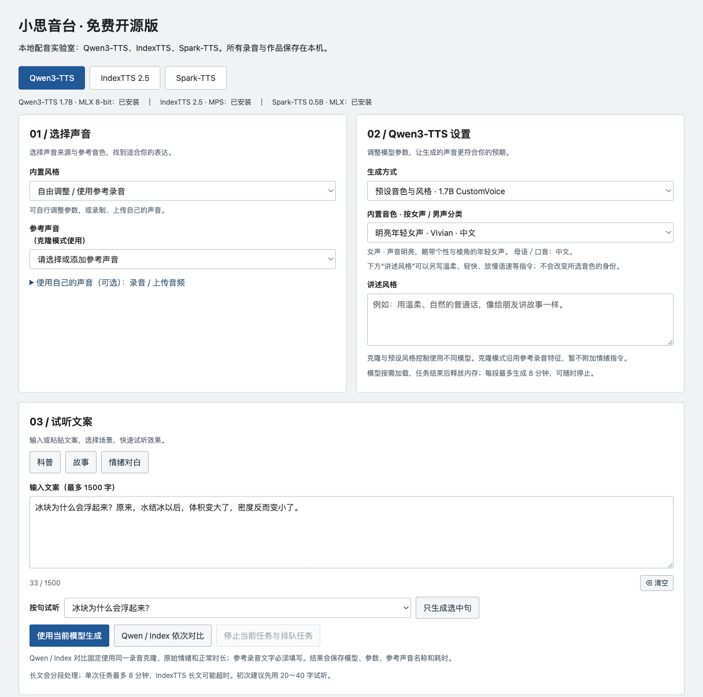
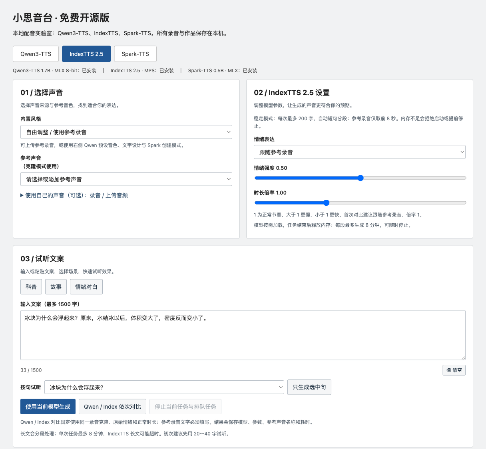
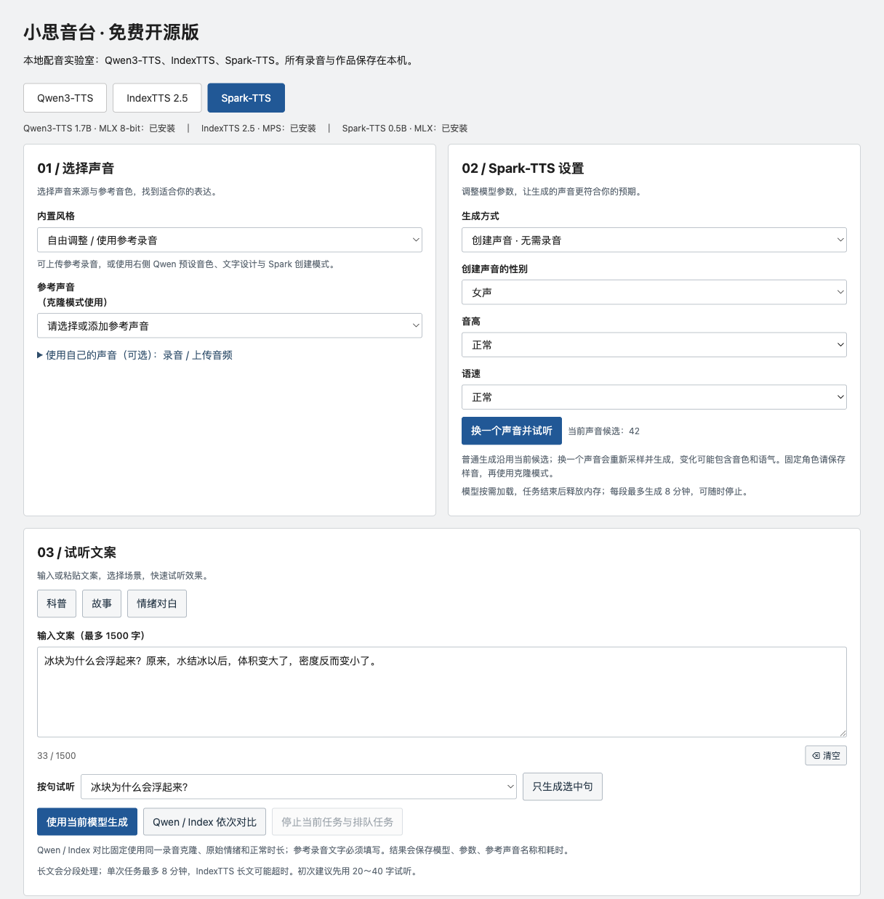

[简体中文](README.md) | **English**

# 小思音台 (Xiaosi Voice Lab) · Local AI Voiceover & Voice Cloning

**Turn text into speech, clone a voice from a reference recording, and try Qwen3-TTS, IndexTTS, and Spark-TTS in one local web interface on your Apple Silicon Mac.**

This free, open-source community edition brings three speech models into one workflow: enter text, choose a voice or reference recording, generate speech, listen, and download the audio. Use it for short-video voiceovers, story narration, educational content, or comparing how different models sound.

After installing dependencies and downloading models, you can work in your browser without writing inference commands for each generation or configuring a cloud speech API key. Models run on your machine; recordings, reusable reference voices, and generated audio stay in the local project directory. The current version targets **Apple Silicon Macs** and uses a simple form-and-results interface.

## What you can do

- **Create voiceovers from scripts.** Choose a built-in voice or a reference recording, generate speech, then listen and download the audio for editing.
- **Clone a voice from your own recording.** Upload or record reference audio you have permission to use, then have the model read new text in that voice.
- **Create voices from descriptions.** Explore voice creation with Qwen or Spark. Spark also provides pitch and speaking-rate choices, plus candidate switching.
- **Reuse reference characters.** Save a generated voice as a reference character and select it again for later scripts.
- **Compare models.** Switch between three models in the same interface, or run Qwen Base and IndexTTS sequentially with the same reference recording.
- **Manage generation history.** Search, filter, and page through results; play, download, or delete audio; inspect audio duration and generation time.

## Three models in one place

| Model | Integrated features | Things to try |
| --- | --- | --- |
| Qwen3-TTS | Reference voice cloning, 9 built-in voices, voice creation from text descriptions | Start with a built-in voice or explore a custom voice |
| IndexTTS 2.5 | Reference voice cloning, emotion controls, duration multiplier, stability mode | Adjust emotion and pacing for short narration passages |
| Spark-TTS | Voice creation, pitch and speaking-rate choices, candidate switching, reference voice cloning | Explore voice settings and pick a suitable candidate |

Quality and speed depend on the model, reference recording, input text, and hardware. IndexTTS includes memory checks, MPS allocation limits, and short-text segmentation; see the limits below.

## Interface screenshots

These screenshots show the actual local community-edition pages, including model settings and the script area. The application interface is currently in Chinese. Screenshots exclude private recordings and generation history; they do not demonstrate a fresh model inference run.

### Qwen: built-in voices and narration style



### IndexTTS: emotion, pacing, and memory protection



### Spark: voice creation, pitch, and speaking rate



## Free, open source, and licensing

The application code is released under the **MIT License** and may be used, modified, distributed, and used commercially. Models, model outputs, and third-party dependencies are governed by their respective licenses. See [THIRD_PARTY.md](THIRD_PARTY.md). The MIT License does not replace model permissions.

This is a separately maintained basic edition extracted and organized from an existing project. Its scope covers local voice workflows for Qwen, IndexTTS, and Spark.

## Quick start

The web server requires Python 3.11 or newer; model environments use Python 3.11. Audio conversion requires system `ffmpeg`. Only Apple Silicon macOS is currently supported; Windows and Linux have not been verified.

### With an existing local runtime

An existing installation may use a Git-ignored `local_runtime.json` to point to installed dependencies and model directories. The application source remains separate, while recordings, reference characters, generated audio, and logs are stored in this repository's `data/` directory. It does not use another edition's output data. Do not upgrade dependencies inside a shared runtime; use the separate installation below if you need independent upgrades.

```sh
zsh start.command
# Open http://127.0.0.1:8776/qwen in your browser
zsh stop.command
```

The default port is **8776**, separate from the original project's 8766. Set `VOICE_LAB_PORT` to change the port or `VOICE_LAB_RUNTIME` to change dependency and model locations. Both web interfaces can be open at once, but running heavy models in both editions simultaneously is discouraged because they share system memory.

### Install from Git

The repository does not include model weights, virtual environments, user audio, or reference characters. Prepare Python 3.11, Git, and ffmpeg.

```sh
git clone https://github.com/waerly/voice-lab-community.git
cd voice-lab-community

# 1. Install MLX dependencies for Qwen and Spark
python3 scripts/setup_runtime.py mlx
# 2. Download the models you need; downloads can be large
runtime/qwen-venv/bin/python download_models.py qwen
runtime/qwen-venv/bin/python download_models.py design
runtime/qwen-venv/bin/python download_models.py spark
# 3. Optional: install IndexTTS upstream source, dependencies, and models
python3 scripts/setup_runtime.py index
runtime/qwen-venv/bin/python download_models.py index
# 4. Start the local web server
zsh start.command
```

The IndexTTS upstream version must provide `indextts.infer_v2_5.IndexTTS2` and support `use_qwen_emo=False`. The setup script currently follows the upstream default branch rather than a pinned source revision; check compatibility before your first installation. Python package versions come from the currently working local environment. **A clean-machine installation and fresh model downloads have not been verified for this extracted edition.** The web service and all three model pages have been checked with existing dependencies; model inference was not rerun during separation.

To create the optional built-in samples for gentle storytelling, lively science narration, and steady explanation, run `python3 prepare_builtin_styles.py` after the Qwen models are ready and the web server is running. This performs real speech generation; the samples are synthetic reference voices, not bundled human recordings.

## Memory and generation limits

IndexTTS accepts up to 200 characters per request, splits text into roughly 40-character segments, uses only the first 8 seconds of reference audio, and performs single-candidate search. Memory is checked before and during generation, with MPS allocation limits; jobs may be rejected or stopped when limits are reached. Other models generally accept up to 1,500 characters. Keep initial voice-design samples within 120 characters. Each job is limited to 8 minutes.

These safeguards cannot eliminate all system or GPU-driver failures. Even a 32 GB Mac may reject an IndexTTS job when other applications use too much memory. Start with 20–40 Chinese characters. Model environments, quantization, and loading overhead differ; reported times reflect the current machine's configuration.

## Development and verification

```sh
python3 -m unittest discover -s . -p 'test_*.py' -v
node test_generation_context.cjs
# WAV workflow tests require soundfile; no real model is loaded
runtime/qwen-venv/bin/python -m unittest discover -s . -p 'test_index_worker.py' -v
```

`server.py` provides local HTTP/API endpoints; `worker.py` runs model jobs in a separate process. `index_resources.py` and `index_worker.py` implement IndexTTS safeguards and segmentation. `classic.css` styles the basic interface; `job_history.py` and `job_list.js` handle generation history.

## Repository contents

Only application source, documentation, and tests belong in Git. `.gitignore` excludes models, virtual environments, recordings, generated audio, private runtime paths, logs, and temporary files. User data stays local and is not published with the source.
